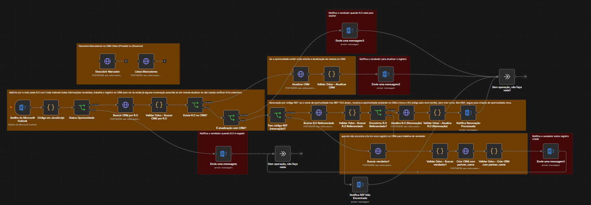

# Registro de Oportunidades Sincronizado com o CRM Odoo

Workflow n8n que lê os e-mails de status dos Registros de Oportunidade (RO) enviados pelo fabricante e mantém o CRM Odoo atualizado sozinho: cria oportunidades novas, atualiza as existentes, processa renovações e avisa o vendedor de cada mudança.

## Problema

Cada mudança de status de um RO (aprovado, rejeitado, renovado, prestes a expirar) chegava por e-mail e precisava ser copiada à mão para o CRM. Com centenas de registros ativos, isso gerava oportunidades duplicadas, datas de vencimento desatualizadas e vendedores sem saber que um registro tinha sido negado ou estava para expirar.

## Solução

O fluxo monitora a pasta de ROs no Outlook e, para cada e-mail, decide o que fazer conforme o status:

| Situação | Ação |
|---|---|
| RO **rejeitado** | Envia e-mail ao vendedor com o motivo da negação |
| RO já existe no CRM | Atualiza o registro (status, vencimento, LOB) e avisa o vendedor |
| Atualização ou expiração de RO que **não está** no CRM | Alerta o vendedor para regularizar |
| Renovação com código **`REF:`** | Localiza a oportunidade antiga, troca o número do RO e incrementa o contador de renovações |
| Código `REF:` que não existe no CRM | Alerta a equipe para conferir o número |
| RO aprovado e novo | Cria a oportunidade no Odoo e avisa o vendedor |

## O que o fluxo extrai de cada e-mail

| Dado | Como é obtido |
|---|---|
| Status | Palavras-chave no assunto (PT e EN) |
| Número do RO e RO de referência | Expressões regulares no corpo do e-mail |
| Cliente e vendedor | Padrão `Cliente \| Vendedor \| Produto` no nome da oportunidade |
| Receita esperada | Valor em USD convertido para BRL |
| Linha de negócio (LOB) | Classificação por família de produto (servidores/storage ou notebooks/desktops) |
| Data de vencimento | Convertida para o formato do Odoo |
| Tipo de cliente | Governo ou Empresa Privada, por regras sobre a razão social |
| Motivo da negação | Trecho do e-mail, enviado ao vendedor em caso de rejeição |

## Destaques técnicos

- **Integração direta com a API JSON-RPC do Odoo** (`search_read`, `create`, `write`, `fields_get`), sem conector pronto.
- **Chave de API fora do workflow:** a autenticação usa a variável de ambiente `$env.ODOO_API_KEY`, então nenhuma credencial fica no arquivo.
- **Renovação sem duplicar oportunidades:** com o código `REF:<RO anterior>`, o fluxo localiza a oportunidade existente, troca o número do RO, guarda o anterior e incrementa o contador de renovações.
- **Validação de cada resposta da API:** nós Code após cada chamada interrompem a execução se o Odoo retornar erro, resposta vazia, RO duplicado ou registro arquivado, evitando gravações erradas.
- **Deduplicação no lote:** se dois e-mails do mesmo RO chegam juntos, só um é processado, priorizando o de criação.
- **Validação de entrada:** o número do RO é verificado antes de entrar em qualquer chamada à API.
- **Notificações HTML compatíveis com Outlook**, uma para cada situação: criação, atualização, renovação, rejeição, expiração e REF não encontrado.

## Tecnologias

Nós utilizados: Microsoft Outlook Trigger · Code · IF · HTTP Request · Microsoft Outlook · No Operation · Sticky Note

## Como usar

1. No n8n, abra **… → Import from File** e selecione `workflow.json`.
2. Defina a variável de ambiente `ODOO_API_KEY` na sua instância do n8n.
3. Nos nós HTTP Request, troque `https://seu-odoo.example.com` e `NOME_DO_BANCO_ODOO` pelos dados do seu Odoo.
4. Configure as credenciais do Outlook e, no gatilho, troque `ID_DA_PASTA_OUTLOOK` pela pasta que recebe os e-mails.
5. No nó **Code in JavaScript**, edite `mapaVendedores` (nome, ID do usuário no Odoo e e-mail) e os IDs das tags de cliente.
6. Ajuste os campos personalizados (`x_studio_*`) para os nomes usados no seu Odoo.
7. Os nós **Descobrir Marcador** e **Listas Marcadores** são auxiliares: execute-os uma vez para descobrir os IDs das tags no seu CRM.

## Possíveis melhorias

- Buscar a cotação do dólar em uma API em vez de usar valor fixo.
- Levar o mapa de vendedores para uma planilha ou tabela do Odoo, para atualizar sem editar o código.

> URLs, banco de dados, pastas, nomes, e-mails, telefone e credenciais foram substituídos por dados fictícios.
